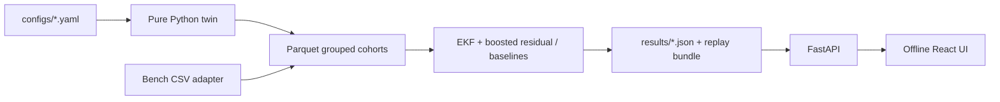

# FilterTwin

**Predictive maintenance concept for household RO purifiers.** Every model metric below is generated from a synthetic digital twin, not from a purifier fleet. UI title: **Atomberg Home (concept UI)**. No Atomberg marks or proprietary hardware assumptions are used.

## Quickstart

1. `make setup` (creates the environment, installs dependencies, and runs the quick pipeline)
2. `make demo` (starts FastAPI and Vite in Demo-Safe-capable mode)

On Windows without GNU Make: run `scripts\setup.ps1`, then `scripts\demo.ps1`. To regenerate the full cohorts between setup and demo, run `make reproduce`.

For a short deterministic run: `make quick`. For the requested full cohort and regenerated evidence: `make reproduce` (or `make full`).

## Current generated run

- Units: {"ood": 12, "test": 12, "train": 48, "validation": 12}
- Rows: {"ood": 10011, "test": 10042, "train": 40157, "validation": 10056}
- Grouped split check: True
- Pipeline wall time: 89.53s on CPU
- Provenance: SIMULATED. External validation and bench data are pending.

## What it demonstrates

- Solution-diffusion RO normalization for pressure, osmotic pressure, and temperature.
- Virtual pump pressure from a configurable current-pressure line.
- Cake filtration and a Thomas-style carbon breakthrough proxy with RO oxidation coupling.
- A small health-state Kalman filter plus gradient-boosted residual correction, baselines, validation conformal calibration, and one-time held-out OOD reporting.
- FastAPI telemetry/evidence/ingest endpoints and an offline replay bundle.
- A bench-rig proposal and adapter path.

## Routes

`/twin`, `/why`, `/app`, `/fleet`, `/evidence`, `/hardware`, `/about`, `/demo`.

## Run evidence

See [docs/EVALUATION.md](docs/EVALUATION.md), [docs/MODEL_CARD.md](docs/MODEL_CARD.md), [docs/CLAIMS_REGISTER.md](docs/CLAIMS_REGISTER.md), and [FINAL_REPORT.md](FINAL_REPORT.md). Charts and app claims carry SIMULATED/PUBLIC DATA/BENCH provenance.

Playwright desktop and phone captures are written to `docs/screenshots/` when the browser gate runs. Vector figures for slides are in `docs/figures/`.

## Architecture

