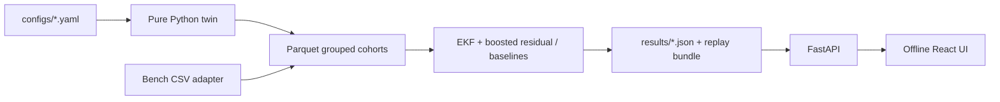

# FilterTwin

**Predictive maintenance concept for household RO purifiers.** Every model metric below is generated from a synthetic digital twin, not from a purifier fleet. UI title: **Atomberg Home (concept UI)**. No Atomberg marks or proprietary hardware assumptions are used.

## Quickstart

Requirements: Git, Python 3.11, and Node.js with Corepack enabled. Corepack selects the pinned pnpm 11.25.0 from `web/package.json`.

Clone the shared repository, then run the setup and demo commands:

```powershell
git clone https://github.com/<owner>/filtertwin.git
cd filtertwin
.\scripts\setup.ps1
.\scripts\demo.ps1
```

Setup creates `.venv`, installs Python and web dependencies, and runs the quick deterministic pipeline. Demo starts FastAPI and Vite and opens `http://127.0.0.1:5173/twin`. Stop the servers with Ctrl+C. On a system with GNU Make, the equivalent commands are `make setup` and `make demo`.

To regenerate the full cohorts and evidence after setup, run `make reproduce` (or `make full`).

For a short deterministic run: `make quick`. For the requested full cohort and regenerated evidence: `make reproduce` (or `make full`).

## Current generated run

- Units: {"ood": 300, "test": 300, "train": 1500, "validation": 300}
- Rows: {"ood": 250698, "test": 250955, "train": 1254008, "validation": 251007}
- Grouped split check: True
- Pipeline wall time: 1127.36s on CPU
- Provenance: SIMULATED. External validation and bench data are pending.

## What it demonstrates

- Solution-diffusion RO normalization for pressure, osmotic pressure, and temperature.
- Virtual pump pressure from a configurable current-pressure line.
- Cake filtration and a Thomas-style carbon breakthrough proxy with RO oxidation coupling.
- A small health-state Kalman filter plus gradient-boosted residual correction, baselines, validation conformal calibration, and one-time held-out OOD reporting.
- FastAPI telemetry/evidence/ingest endpoints and an offline replay bundle.
- A bench-rig proposal and adapter path.

## Routes

`/twin`, `/why`, `/app`, `/fleet`, `/evidence`, `/hardware`, `/about`, `/demo`.

## Run evidence

See [docs/EVALUATION.md](docs/EVALUATION.md), [docs/MODEL_CARD.md](docs/MODEL_CARD.md), [docs/CLAIMS_REGISTER.md](docs/CLAIMS_REGISTER.md), and [FINAL_REPORT.md](FINAL_REPORT.md). Charts and app claims carry SIMULATED/PUBLIC DATA/BENCH provenance.

Playwright desktop and phone captures are written to `docs/screenshots/` when the browser gate runs. Vector figures for slides are in `docs/figures/`.

## Architecture


