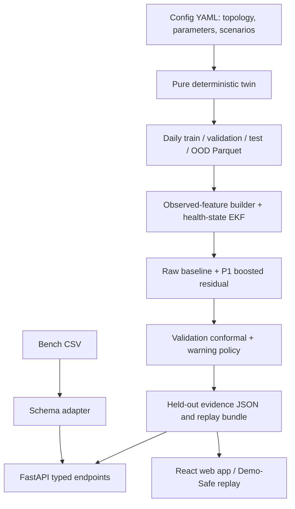

# Architecture

The twin is pure with respect to the file system after parameters are loaded; generation owns data I/O. The API serves generated Parquet and JSON, and an optional websocket streams rows from a local replay. The web app can load the checked-in/precomputed gzip replay if the API is unavailable.

